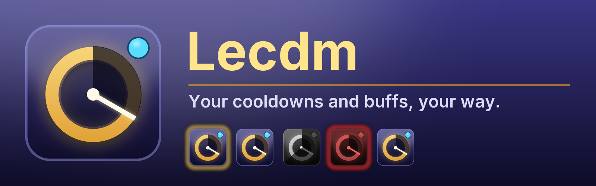

# lecdm

Lecdm is a **World of Warcraft: Forever** addon that makes Blizzard's Cooldown Manager better and
simpler to manage: your cooldowns in icon bars, your buffs from anyone as icons or timer bars,
your debuffs on the target, and sounds and glows that work in combat, all laid out and styled
your way from one window. It builds on what Blizzard's Cooldown Manager knows instead of fighting
it: no Edit Mode trips, no forced reloads, nothing read that the game hides.

**Status:** 0.9.0-alpha (2026-11-21), the first alpha. The core is tried in game, in the open
world and in dungeons (TESTING.md lists what's confirmed); the rest is checked against a
stand-in for the Forever API. The plan and what's next are in [ROADMAP.md](ROADMAP.md).

## Install

- **A release:** unzip `release/Lecdm-<version>.zip` (it holds the `Lecdm` folder) into
  `World of Warcraft\_forever_\Interface\AddOns\`, then restart the game.
- **For development on Windows:** clone the repo (`git clone https://github.com/addohm/lecdm.git`),
  check `WOW` at the top of `tools\install_forever.cmd` (default
  `C:\Program Files (x86)\World of Warcraft\_forever_`), and run it from a terminal. It pulls,
  copies `Lecdm` into the client, stamps the build and packs `Lecdm-<version>.zip` on your
  desktop. Fully restart the game when it says so, otherwise `/reload`. `/lecdm help` shows the
  build you're running.

## Usage

`/lecdm` (or `/lcdm`), the minimap button, the addon menu by the minimap, or Options > AddOns >
Lecdm opens the options window. `/lecdm move` unlocks everything Lecdm shows: each piece shows
its name on a blue shade and can be dragged; `/lecdm move` again locks it.

- **General:** Enable Lecdm, the minimap button, the login reminder, a class-coloured window,
  Reset all settings, the chat commands.
- **Icon bars:** your cooldowns in rows of icons. The dropdown at the top picks an icon bar;
  its last entry, "New icon bar...", makes one (it asks for a name). Everything below is about
  the bar picked:
  - its name and layout: icon size, spacing, grow from (centre, left or right), vertical, icons
    per row, the GCD sweep, and items you have none of (hidden, or greyed with a 0);
  - its look: border and colour, icon zoom, the swipe (normal, reversed or none; its colour;
    a bright edge), countdown text size and, near the end (under a time you pick), a colour or a
    decimal, keybind text (the key of the
    first action button on screen holding it, from any bar addon), the game's tooltip on hover
    (off by default, so clicks go through; on; or out of combat only), grey on cooldown and its
    opacity then, red out of range, dark when unusable; for spells with charges the count (the
    game's, in combat too) and the recharge swipe, 0 shown or not;
  - when it shows: always, only in combat, or in combat or with a target; opacity; out of
    combat the same, faded or hidden; and Delete;
  - its spells and items: tick them in the checklist (Blizzard's Essential and Utility lists,
    your spellbook, your equipped trinkets and on-use gear, usable items in your bags; an entry
    on another bar says "(on ...)" and ticking moves it), order them with the arrows, choose
    when each shows (always, only when ready, only when ready and usable: Overpower, Revenge,
    Execute; only on cooldown; the others close up), and in its ⚙ menu: while its buff is up
    (Death Wish, Shield Block, Slice and Dice), show the buff on it (the game's own button: its
    time as a swipe in the bar's "while its buff is up" colour, its stacks, a glow; in combat
    too); when it shows: in or out of a stance or form (Battle Stance, Bear Form...) and only
    with or without a talent; and its
    own alerts (⚙). A trinket slot shows whatever's equipped there while it has a use effect;
    spells you haven't learned appear once you do.

  The first time, two icon bars are filled from Blizzard's list. Blizzard's own Essential and
  Utility icons are made invisible while Lecdm's icon bars are on (they keep running); untick
  "Hide Blizzard's Essential and Utility icons" to keep them.
- **Buffs:** laid out like Icon bars, for buff groups: buffs on you from anyone (your own,
  another priest's Fortitude, world buffs, procs). For the group picked: its name, **Show as**
  icons (a swipe, the time left, stacks) or **timer bars** (the icon, then a bar draining to the
  right with the name and the time left), its layout, look (border, zoom, time text, the swipe
  and its colour, the game's
  tooltip on hover: on, out of combat only, or off; for timer bars texture, colour, background,
  and icon, name and time each on or off), when it shows, and
  its buffs: tick them from **Lecdm's list** (your class's buffs, your procs and cooldowns,
  buffs other classes put on you, your race's, world buffs, consumables: every rank, and group
  versions count too, so Prayer of Fortitude is Power Word: Fortitude; weapon enchants: oils,
  sharpening stones, poisons, a shaman's weapon spells, always in a place of their own), from
  your buffs in
  Blizzard's list, or from the buffs on you now (out of combat), order them, choose how each shows (**while it's up**, **keep up**: a fixed place with
  a copy of it and a glow while it's down, or **only while missing**), and its own alerts and
  looks.
  Every rank of a buff, whoever cast it, and its full duration are learned the first time Lecdm
  sees it on you out of combat. Changes made in combat apply when it ends.

  Lecdm shows only what you set up: Blizzard's own buff icons and timer bars (what its
  Cooldown Manager tracks in its Buffs tab) are **hidden** by default. They keep running, so
  the in-combat sounds still hear them. The dropdown has them as **Blizzard's icons** and
  **Blizzard's timer bars**, for anyone who wants their debuffs on the target (only Blizzard
  can time those): **hide them** (the default), **take them into Lecdm** (Lecdm's own place,
  spaced and grown your way, gaps closed, following each target), or **leave them** where
  Blizzard shows them; and when they show. Which ones and their order are picked in
  `/cdm` (Tracked Buffs for icons, Tracked Bars for timer bars; "Open /cdm" is right there);
  their size is Edit Mode's.
- **Alerts:** the sounds and glows every spell and buff gets unless it has its own (the ⚙ on
  its row: a submenu per setting, "Default (...)" first). Each glow picker has a sample icon
  showing the glow and colour picked; each sound picker a Test button. Sounds are the game's (raid warning,
  ready check, alarm clock ...) or "Say it", which speaks the name.
  - Icon bars: a sound when it's ready (off cooldown, not the GCD), a glow while it's ready and
    usable, a glow while the game highlights it (a proc), a glow while it's on cooldown, a glow
    at full charges, a glow while its buff is up (for spells showing it); glow colour.
  - Buff groups: sounds when it's applied and when it drops (in combat only for buffs
    Blizzard's `/cdm` also tracks, from its announcement; out of combat for every buff on you);
    a sound as it **runs out**, at the warning time (out of combat from its own timer; in combat
    from its time when the fight started or from your own cast, once Lecdm has seen it out of
    combat; quiet in combat when someone else in your group could have recast it: another
    priest for Fortitude); going into combat **without a keep-up buff**: a sound, and which ones in chat;
    a glow while it's up, the warning time (the time turns red under it: 3 s to 2 min, or each
    buff's own: Lecdm's list's, else a tenth of its duration) and a warning glow then
    (icons, timed by the game from the buff's learned duration), a glow while a keep-up buff is
    missing (red pixel glow by default); colours.
  - Buff groups, how a buff looks: **grey** and its **opacity** while it's up (so a missing one
    stands out; icons come back to full strength at the warning time, in combat too, once its
    duration is known; glows stay at full strength), and what a keep-up buff's place shows
    while it's missing: a copy in **full colour**, **grey** or **dimmed red** (the default), at
    its own opacity. For "grey and faded while up, full colour and glowing while missing": Grey
    while it's up Yes, Opacity 40%, Look while it's missing Full colour, and the buff on Keep up.
  - Blizzard's icons and timer bars: sounds when it's applied and when it drops; quiet when
    your target dies, unless "Also when your target dies".
- **Diagnostics:** where Lecdm's diagnostic lines go ("Show them in" the main chat window, a
  chat tab you've made, or nowhere: the log keeps them), and tools: Blizzard's viewers
  invisible (a test, not kept), status, Blizzard's list, what's readable now, the sound log
  (every sound any addon plays goes in the log, with the addon that played it and, for Lecdm's
  own, why), and the log, ready to copy into a bug report.
- **Profiles:** each character starts with its own ("First Last"); pick another to share it,
  copy, rename, delete, reset, or switch automatically by your talents or group role.

Chat commands:

| Command | What it does |
|---|---|
| `/lecdm` | Open or close the options window |
| `/lecdm general` ... `profiles` | Open that tab (`bars`, `buffs`, `alerts`, `diagnostics` too) |
| `/lecdm move` | Unlock everything to drag it; again to lock |
| `/lecdm profile` | The profile in use, and the Profiles tab |
| `/lecdm buff` | Your buff groups' buffs; `/lecdm buff fort keep` (any part of a name; `keep`, `missing`, `up`, `out`) sets one |
| `/lecdm minimap` | Show or hide the minimap button |
| `/lecdm on` / `off` | Turn Lecdm on or off |
| `/lecdm help` | The commands, and the build |
| `/lecdm status` | Is Blizzard's Cooldown Manager available, what it lists, what's listened to |
| `/lecdm list` | Every entry Blizzard's Cooldown Manager lists for you, by section |
| `/lecdm check` | What an addon can read about your spells right now (try it in combat) |
| `/lecdm blizz hide` / `show` | Make Blizzard's cooldown viewers invisible, or bring them back (a test) |
| `/lecdm log` | The log in a window, ready to copy; `/lecdm log clear` empties it |
| `/lecdm soundlog on` / `off` | Log every sound any addon plays, with the addon (and Lecdm's reason) |

## Docs

- [ROADMAP.md](ROADMAP.md): the plan, what's done and what's next
- [TESTING.md](TESTING.md): what to check in game, and the results
- [CHANGELOG.md](CHANGELOG.md): what changed in each version
- [LISTING.md](LISTING.md): the CurseForge and Wago page text
- [DEPLOY.md](DEPLOY.md): installing on the test PC, and releases
- [SECURITY.md](SECURITY.md): secrets, access, reporting problems
- [CLAUDE.md](CLAUDE.md): notes for Claude working on it
